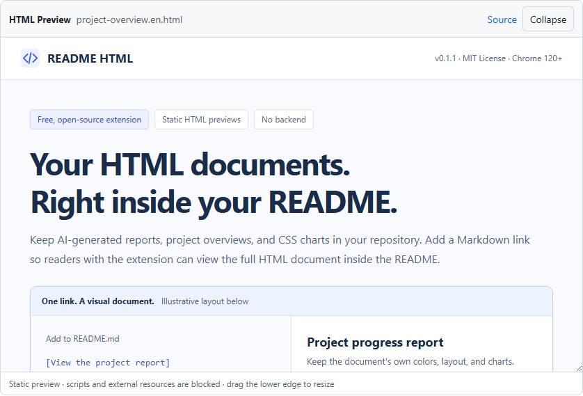

<div align="center">


# README HTML

**Your HTML documents. Right inside GitHub.**

A free, open-source Chrome extension for static HTML previews on GitHub.

[](https://github.com/luty4ng/readme-html/releases/tag/v0.1.2)

[](./LICENSE)
[](https://github.com/luty4ng/readme-html/actions/workflows/ci.yml)

**[Download](https://github.com/luty4ng/readme-html/releases/download/v0.1.2/readme-html-v0.1.2.zip)** · [Quick start](#quick-start) · [Live demo](#live-demo) · [FAQ](#frequently-asked-questions) · [Issues](https://github.com/luty4ng/readme-html/issues)

**English** · [简体中文](./docs/zh-CN/README.md)



<sub>Actual extension preview on GitHub. Document metrics are mock data.</sub>

</div>

Add a link ending in `#html-preview` to render an HTML file from the same public repository below it. Or open a repository’s `.html` / `.htm` file page to preview it automatically, with no marker required. Each reader needs the extension installed. No account, build step, or separate hosting is required.

> [!NOTE]
> **Developer preview · Chrome 120+.** Install through Developer mode while Chrome Web Store review is pending.

## Quick start

**Ask your AI assistant to help install it.** Copy this prompt into a local assistant with terminal access:

```text
Help me install README HTML in desktop Chrome 120+:
1. From https://github.com/luty4ng/readme-html/releases/tag/v0.1.2 download readme-html-v0.1.2.zip and readme-html-v0.1.2.zip.sha256. Verify the ZIP's SHA-256; stop on mismatch.
2. Extract to a permanent, versioned folder without overwriting an existing installation. Confirm manifest.json is at its root, with name README HTML and version 0.1.2. No build or npm install is needed.
3. Open chrome://extensions and help me enable Developer mode → Load unpacked → select that folder. If you cannot operate the page, give me the absolute path and guide the clicks. Verify loading or wait for my confirmation before claiming installation is complete.
4. Open https://github.com/luty4ng/readme-html and refresh. Verify the inline preview under “Live demo”; ask me to confirm if you cannot inspect it.
Keep the folder in place. Explain manual updates. Do not change browser security policies or modify my repositories. Clearly report unverified steps.
```

**Install manually:** Download the [ZIP](https://github.com/luty4ng/readme-html/releases/download/v0.1.2/readme-html-v0.1.2.zip) ([SHA-256](https://github.com/luty4ng/readme-html/releases/download/v0.1.2/readme-html-v0.1.2.zip.sha256)), extract it, then open `chrome://extensions` → **Developer mode** → **Load unpacked** → select the folder containing `manifest.json`. Keep that folder and refresh GitHub.

<details>
<summary>Install from source or update</summary>

Clone `https://github.com/luty4ng/readme-html.git` and load its `extension` folder instead. Developer-mode installs do not auto-update: replace the extracted files or pull the source, click **Reload** on the extension card, then refresh GitHub.

</details>

## Live demo

With the extension enabled, the English document appears below this link:

[Open the visual project overview](./demo/project-overview.en.html#html-preview)

Try the contents links, FAQ, collapse, and resize controls. The SVG and CSS charts use labeled mock data. Without the extension, the ordinary file link remains. [Open the HTML file directly](./demo/project-overview.en.html) · [All demos →](./demo/README.md)

## Embed your own document

Save a self-contained `docs/report.html` in your public repository. Add this link in its own paragraph in the root README, then commit both files:

```markdown
[View the report](./docs/report.html#html-preview)
```

Paths are relative to the README. Use inline CSS and static SVG or CSS charts, with no JavaScript or external assets. [Complete HTML example and tutorial →](./docs/EMBED_HTML_IN_GITHUB_README.md)

## Compatibility

- **Public `github.com` repositories:** same-repository `.html` / `.htm`, UTF-8, ≤ 1 MiB, 15-second fetch timeout. Supports HTML file pages, repository READMEs, and standalone `README.md` / `README.markdown` pages. File pages show a window-sized preview and hide source after rendering; failed previews leave source visible.
- **Static documents:** inline CSS, SVG, permitted base64 raster images, data fonts, and native `<details>`. Multiple previews, resize, retry, and collapse; long documents scroll internally.
- **Not supported:** JavaScript, external or relative assets, private repositories, Enterprise, GitLab, Issues/PRs, and cross-repository previews. For translated READMEs, use language folders such as `docs/zh-CN/README.md`.

## Frequently asked questions

### Can GitHub display HTML without this extension?

GitHub accepts selected HTML in Markdown but [sanitizes scripts and inline styles](https://github.com/github/markup#github-markup). An `.html` file link does not embed the styled document.

### Does every reader need the extension?

Yes. Readers without it see the original file link; provide a screenshot or hosted page for them.

### Can it run JavaScript or load external resources?

No. Documents render in a sandbox; use self-contained static HTML. See [compatibility](#compatibility).

### Does it support private repositories?

No. Version 0.1.2 reads public files from the same repository on `github.com` only.

### Is it free, and does it collect data?

Free under MIT, with no account, analytics, or persistent usage storage. Public files load directly from GitHub Raw without credentials; GitHub receives those requests. [Privacy policy →](./PRIVACY.md)

### How does it compare with GitHub Pages or a screenshot?

Use README HTML for inline static documents, [GitHub Pages](https://docs.github.com/en/pages/getting-started-with-github-pages/what-is-github-pages) for a website without an extension, or a screenshot for a fixed visual summary.

## Troubleshooting

| Symptom | Check |
| --- | --- |
| Only a file link | Enable the extension, refresh GitHub, and keep the `#html-preview` link in its own paragraph. |
| File not found | Check the public repository, committed file, branch, and relative path, then click **Retry**. |
| Missing styles or charts | Inline CSS and assets; replace JavaScript charts with static SVG or CSS. |

## Documentation

[HTML tutorial](./docs/EMBED_HTML_IN_GITHUB_README.md) · [Development and tests](./docs/DEVELOPMENT.md) · [Distribution guide (中文)](./docs/PUBLISHING.md) · [Privacy](./PRIVACY.md) · [Report an issue](https://github.com/luty4ng/readme-html/issues)
