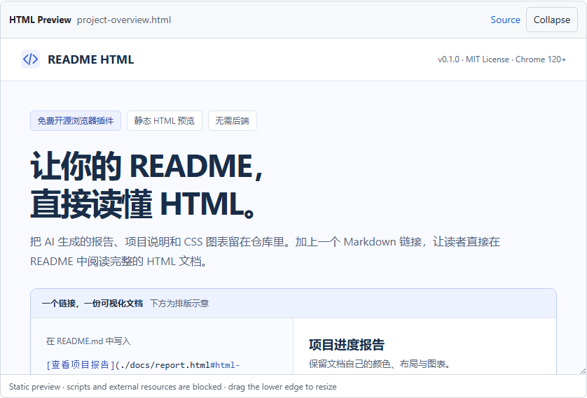

<div align="center">


# README HTML

### Your HTML documents. Right inside GitHub.

**Turn one Markdown link into a visual document.**<br>
Keep reports, diagrams, and project overviews beside your code.<br>
Read them in your README with a free, open-source Chrome extension.

[](https://github.com/luty4ng/readme-html/releases/tag/v0.1.1)

[](./LICENSE)

**[Download](https://github.com/luty4ng/readme-html/releases/download/v0.1.1/readme-html-v0.1.1.zip)** · **[Live demo](#live-demo)** · [Documentation](#documentation) · [Report an issue](https://github.com/luty4ng/readme-html/issues)

**English** · [简体中文](./docs/zh-CN/README.md)

<br>



<sub>Actual extension preview on this repository. Sample metrics in the document are mock data.</sub>

</div>

<br>

> [!NOTE]
> **Developer preview · Chrome 120+ · public GitHub repositories.** Installation currently uses Developer mode. README HTML is not yet listed in the Chrome Web Store.

## Is this for you?

You have an HTML report, an architecture overview, or an AI-generated document—and want readers to see it where they already read your code.

- **Share visual documents where people already read.** Reports, project overviews, diagrams, and comparison tables can live beside the code that explains them.
- **Embed with one Markdown link.** Use inline CSS, SVG, CSS charts, and native expandable sections without deploying a separate website.
- **Start without an account or build step.** No API key, backend, analytics, or runtime dependencies. Free to use, modify, and redistribute under MIT.

The README stays ordinary Markdown. With the extension, this link adds a static preview below it:

```markdown
[View the report](./docs/report.html#html-preview)
```

## Quick start

**1 · Install the extension.**

Download and extract the [extension ZIP](https://github.com/luty4ng/readme-html/releases/download/v0.1.1/readme-html-v0.1.1.zip). Open `chrome://extensions`, enable **Developer mode**, click **Load unpacked**, and select the folder containing `manifest.json`.

**2 · Open the demo.**

Visit [this repository](https://github.com/luty4ng/readme-html), refresh if it was already open, and scroll to the [live demo](#live-demo). The document appears below its link automatically; there is no toolbar button to click.

**3 · Add your own document.**

Save a self-contained HTML file in your public repository, add a marked link to its README, and commit both files. Follow the [embedding guide](#embed-your-own-document) below. No build step or separate hosting is required.

<details>
<summary>Install from source or update an existing installation</summary>

Clone the repository, then load its `extension` folder in `chrome://extensions`:

```sh
git clone https://github.com/luty4ng/readme-html.git
```

An unpacked extension does not automatically update. Replace the extracted files or pull the latest source, click **Reload** on the extension card, and refresh GitHub. Keep the loaded folder in place while using the extension.

</details>

## Live demo

With README HTML enabled, **a visual project document appears below this link**:

[Open the visual project overview](./demo/project-overview.html#html-preview)

Try its table of contents, expand an FAQ, collapse the preview, or drag the preview's lower edge to resize it. This Chinese-language sample includes inline SVG, CSS bar/donut charts, and a compatibility table. Its sample metrics are labeled **Mock data**.

Without the extension, the original GitHub file link remains available. See the screenshot above for the rendered result, or try the [smaller English example](./demo/README.md).

## Embed your own document

1. Save a self-contained UTF-8 HTML document as `docs/report.html` in your **public GitHub repository**.
2. Add this link to the root README, in its own paragraph:

   ```markdown
   [View the report](./docs/report.html#html-preview)
   ```

3. Commit both files, then open the README on GitHub with the extension enabled. The preview appears below the link.

Use a path relative to the README you are editing. The HTML must belong to the same repository; GitHub Pages is not required.

<details>
<summary>A minimal HTML document you can copy</summary>

Save this as `docs/report.html`:

```html
<!doctype html>
<html lang="en">
<meta charset="utf-8">
<meta name="viewport" content="width=device-width, initial-scale=1">
<title>Project report</title>
<style>body{font:16px/1.6 system-ui;padding:24px;color:#1f2328}h1{color:#0969da}</style>
<h1>Project report</h1>
<p>This HTML document is stored alongside the code.</p>
<details><summary>Implementation notes</summary><p>Inline CSS and native HTML work without JavaScript.</p></details>
</html>
```

</details>

**Generating a report with AI?** Ask for a single UTF-8 HTML file, inline CSS, SVG or CSS charts, and no JavaScript or external resources.

## Compatibility

| Supported | Current boundaries |
| --- | --- |
| Repository home, tree views containing a README, and standalone `README.md` / `README.markdown` pages | Public repositories on `github.com` |
| Same-repository `.html` / `.htm` files with `#html-preview` | UTF-8, up to 1 MiB; 15-second fetch timeout |
| Inline CSS, inline SVG, base64 raster images, and data fonts | External styles, fonts, images, and relative asset files are blocked |
| Multiple previews, collapse/expand, resize, retry, and native `<details>` | Fixed initial height with internal scrolling; no automatic content height |
| README updates during GitHub navigation | Unusual branch/path combinations still need wider field testing |

JavaScript, private repositories, GitHub Enterprise, GitLab, Issues/PRs, and cross-repository previews are outside the current version's scope. Edge installation has not been manually verified.

For translated documents with live previews, use a language folder such as `docs/zh-CN/README.md`; filenames such as `README.zh-CN.md` are not currently recognized as standalone README pages.

## Privacy and isolation

The extension reads marked links on GitHub and fetches public files directly from `raw.githubusercontent.com`, without cookies or authentication credentials. It processes HTML in browser memory and has no telemetry, account, storage, or third-party preview server.

Documents render in a sandboxed iframe with a restrictive CSP. Scripts, event handlers, refresh directives, nested frames, and external resource/navigation attributes are removed. An isolated document can still contain misleading text; this viewer does not authenticate its content.

GitHub receives the public file requests needed for previews. See the [privacy policy](./PRIVACY.md) and [isolation details](./docs/DEVELOPMENT.md#isolation-and-permissions).

## Troubleshooting

| What you see | What to check |
| --- | --- |
| An ordinary file link, with no preview | Enable the extension for GitHub, refresh the page, and confirm the link ends with `#html-preview` in its own paragraph. |
| “File not found” | Check that the HTML is committed, its relative path and branch are correct, and the repository is public. Then click **Retry**. |
| Missing images, fonts, or styling | Inline the CSS; use inline SVG or base64 raster images. External and relative asset files are blocked. JavaScript does not run. |

Still stuck? [Report an issue](https://github.com/luty4ng/readme-html/issues) with your Chrome version, a minimal public example, and the expected and actual behavior. Exclude tokens and private content.

## Documentation

Node 22+ is used for tests; Playwright is a development-only dependency.

```sh
npm ci
npm test
npx playwright install chromium
npm run test:browser
```

Small fixes and reproducible compatibility reports are welcome.

| Resource | Contents |
| --- | --- |
| [Development guide](./docs/DEVELOPMENT.md) | Architecture, permissions, fixture tests, and real GitHub checks |
| [Distribution guide](./docs/PUBLISHING.md) · 中文 | ZIP packaging and Chrome Web Store preparation |
| [Privacy policy](./PRIVACY.md) | Data handling, GitHub requests, and user choices |
