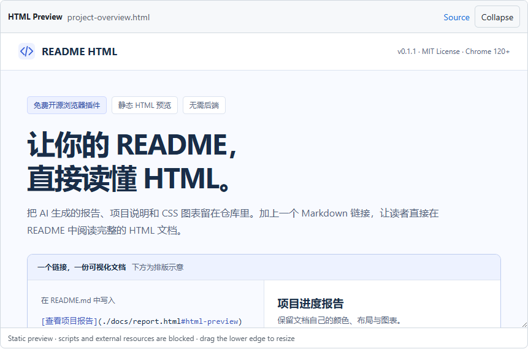

<div align="center">


# README HTML

**让 HTML 文档，直接出现在 GitHub README 里。**

免费开源的 Chrome 插件，在 GitHub README 和 HTML 文件页预览静态文档。

[](https://github.com/luty4ng/readme-html/releases/tag/v0.1.2)

[](../../LICENSE)
[](https://github.com/luty4ng/readme-html/actions/workflows/ci.yml)

**[下载插件](https://github.com/luty4ng/readme-html/releases/download/v0.1.2/readme-html-v0.1.2.zip)** · [快速开始](#快速开始) · [在线演示](#在线演示) · [使用问答](#使用问答) · [反馈问题](https://github.com/luty4ng/readme-html/issues)

[English](../../README.md) · **简体中文**



<sub>GitHub 上的真实插件预览，文档指标均为模拟数据。</sub>

</div>

在链接末尾添加 `#html-preview`，即可在下方渲染同一公开仓库的 HTML 文件。也可直接打开仓库的 `.html` / `.htm` 文件页，自动显示预览，无需标记。每位读者都需要安装插件，无需账号、构建或额外托管。

> [!NOTE]
> **开发预览版 · Chrome 120+。** Chrome 应用商店审核期间，通过开发者模式安装。

## 快速开始

**先让 AI 帮你安装。** 将下面的提示词复制给能执行本地命令的 AI 助手：

```text
请帮我在桌面版 Chrome 120+ 安装 README HTML：
1. 从 https://github.com/luty4ng/readme-html/releases/tag/v0.1.2 下载 readme-html-v0.1.2.zip 和 readme-html-v0.1.2.zip.sha256，比对 ZIP 的 SHA-256，不一致时停止。
2. 解压到长期保留、带版本号的文件夹，不覆盖现有安装。确认根目录有 manifest.json，名称为 README HTML，版本为 0.1.2。无需构建或 npm install。
3. 打开 chrome://extensions，引导我开启开发者模式 → 加载已解压的扩展程序 → 选择该文件夹。无法操作页面时，给出绝对路径和点击步骤；验证加载成功或等我确认后，才能宣告安装完成。
4. 打开 https://github.com/luty4ng/readme-html/blob/main/docs/zh-CN/README.md 并刷新，验证“在线演示”下的行内预览；无法查看时让我确认。
保留安装文件夹，说明需要手动更新。不要更改浏览器安全策略或修改我的仓库，明确说明尚未验证的步骤。
```

**手动安装：** 下载 [ZIP](https://github.com/luty4ng/readme-html/releases/download/v0.1.2/readme-html-v0.1.2.zip)（[SHA-256](https://github.com/luty4ng/readme-html/releases/download/v0.1.2/readme-html-v0.1.2.zip.sha256)）并解压，打开 `chrome://extensions` → **开发者模式** → **加载已解压的扩展程序** → 选择包含 `manifest.json` 的文件夹。保留该文件夹，然后刷新 GitHub。

<details>
<summary>从源码安装或更新</summary>

克隆 `https://github.com/luty4ng/readme-html.git`，改为加载其中的 `extension` 文件夹。开发者模式安装不会自动更新：替换解压文件或拉取源码后，点击插件卡片的**重新加载**，再刷新 GitHub。

</details>

## 在线演示

启用插件后，下方链接后会直接出现中文文档：

[打开可视化项目说明](../../demo/project-overview.html#html-preview)

可以点击目录、展开问答、收起预览或拖动底边调整高度。SVG 和 CSS 图表均使用标明的模拟数据。未安装插件时保留普通文件链接。[直接打开 HTML 文件](../../demo/project-overview.html) · [全部演示 →](../../demo/README.md)

## 嵌入自己的文档

在公开仓库保存自包含的 `docs/report.html`，在根目录 README 中单独一段写入以下链接，再提交两个文件：

```markdown
[查看报告](./docs/report.html#html-preview)
```

路径相对于当前 README。使用内嵌 CSS、静态 SVG 或 CSS 图表，不使用 JavaScript 和外部资源。[完整 HTML 示例与教程 →](./EMBED_HTML_IN_GITHUB_README.md)

## 兼容性

- **仅 github.com 公开仓库：** 同仓库 `.html` / `.htm`，UTF-8，≤ 1 MiB，请求超时 15 秒。支持 HTML 文件页、仓库 README 和独立的 `README.md` / `README.markdown` 页面；文件页按窗口高度显示预览，渲染成功后隐藏源码，失败时保留源码。
- **静态文档：** 内嵌 CSS、SVG、允许的 Base64 位图、data 字体及原生 `<details>`。支持多个预览、调整高度、重试和收起，长文档在内部滚动。
- **暂不支持：** JavaScript、外部或相对路径资源、私有仓库、Enterprise、GitLab、Issue/PR 及跨仓库预览。多语言 README 使用 `docs/zh-CN/README.md` 这样的语言目录。

## 使用问答

### GitHub 本身能显示 HTML 吗？

GitHub Markdown 接受部分 HTML，但会[清理脚本和内嵌样式](https://github.com/github/markup#github-markup)。链接到 `.html` 文件，不会直接嵌入带样式的文档。

### 每位读者都需要安装插件吗？

是的。未安装时显示原有文件链接，可同时提供截图或托管网页供读者查看。

### 支持 JavaScript 或外部资源吗？

不支持。文档在沙箱中渲染，请使用自包含的静态 HTML，详见[兼容性](#兼容性)。

### 支持私有仓库吗？

不支持。v0.1.2 仅读取 `github.com` 同一公开仓库的文件。

### 免费吗，会收集数据吗？

采用 MIT 许可证，无需账号，没有统计服务或持久化使用记录。公开文件直接从 GitHub Raw 读取，不携带认证凭据；GitHub 会收到这些请求。[隐私政策 →](../../PRIVACY.md)

### 和 GitHub Pages、截图有什么区别？

README HTML 适合行内静态文档；[GitHub Pages](https://docs.github.com/en/pages/getting-started-with-github-pages/what-is-github-pages) 适合无需插件的网站；截图适合固定的视觉摘要。

## 常见问题

| 现象 | 检查项 |
| --- | --- |
| 只有文件链接 | 启用插件、刷新 GitHub，让 `#html-preview` 链接独占一段。 |
| 文件不存在 | 检查公开仓库、已提交文件、分支和相对路径，再点击 **Retry**。 |
| 样式或图表缺失 | 内嵌 CSS 和资源，将 JavaScript 图表改为静态 SVG 或 CSS。 |

## 文档

[HTML 教程](./EMBED_HTML_IN_GITHUB_README.md) · [开发与测试](../DEVELOPMENT.md) · [上架与分发](../PUBLISHING.md) · [隐私政策](../../PRIVACY.md) · [提交问题](https://github.com/luty4ng/readme-html/issues)
